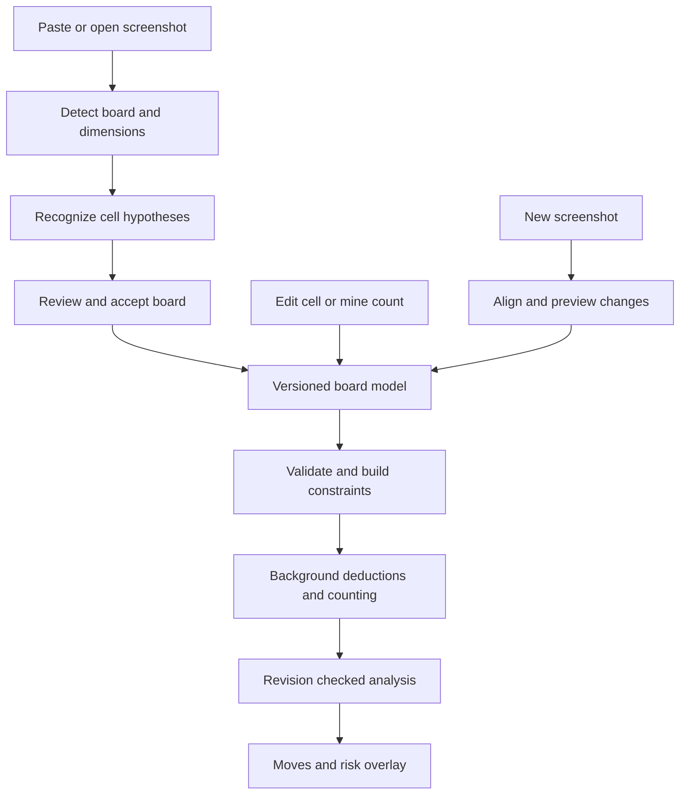

# Minesweeper Application Architecture

## Proposed components

| Component | Responsibility |
| --- | --- |
| Tauri desktop shell | Window, file import/export, local persistence, clipboard fallback |
| Svelte interface | Dark-mode shell, grid editor, source-image comparison, move list |
| TypeScript board store | Validated session state, reversible edits, revisions, UI selections |
| Rust recognition task | Geometry detection, tile preprocessing, local glyph matching |
| Rust solver library | Pure board validation, constraint reasoning, exact counting, explanations |
| Rust background task | Search budgets, progress, cancellation, and revision-tagged results |

Use browser clipboard-image paste events where available; add a narrow Tauri clipboard capability if native image access requires it. Decode images locally. Package recognition assets with the app for offline use. All production recognition algorithms run in Rust. The current implementation uses the image crate and local glyph references. Evaluate Rust OpenCV or ONNX bindings for later recognition improvements; do not move algorithm execution into JavaScript. Training tools can use Python during development without requiring Python on a user's computer.

Keep solver and recognition modules independent of GUI state. The current Tauri crate exposes pure Rust modules for testing; extracting a standalone engine crate is a later cleanup. Execute expensive work outside the main/UI thread. IPC boundaries accept validated semantic board snapshots, never screenshot-specific color rules. Counts that exceed JSON's numeric range travel as decimal strings; display probabilities include classification and exactness metadata.

## Update flow

Increment the revision on every semantic edit. Cancel previous work and suppress stale advice. The frontend accepts results only for the matching revision and assumptions. Analysis may establish new deductions, but must not mutate input clues or change input flags; every input flag is already an asserted mine.

## Delivery sequence

1. **Manual board and exact solver:** establish model correctness, dark-mode editing, and probability presentation.
2. **Geometry prototype and corpus:** demonstrate automatic dimensions across actual source families; keep a correction path.
3. **Cell recognition and review:** choose the smallest recognition approach that meets measured whole-board quality.
4. **Complete screenshot workflow:** merge imports with manual edits, recalculate, persist, and export.
5. **Performance and advanced strategy:** optimize hard frontiers and add explicitly labeled approximate or lookahead options.

Recognition is the main empirical risk. The plan assumes access to a varied labeled screenshot corpus; collecting it is a build task, not a completed capability. Exact solving has potentially exponential cost, so arbitrary custom dimensions do not imply instantaneous results.

## Verification and release gates

Keep solver fixtures independent from scanner fixtures. A scanner label error must not be mistaken for a solver defect. Use exhaustive tiny-board reference tests, semantic import/export tests, screenshot benchmarks with held-out theme families, and end-to-end editing/import tests.

Record actual timing on the user's target Windows machine for common 9×9, 16×16, 30×16, and custom boards. Include hostile large connected frontiers. Ship cancellation and bounded resource handling before promising large-board support. Verify offline cold starts, packaged model loading, clipboard behavior, dark-mode contrast, and keyboard-only operation in the installed Tauri app.

The first implementation includes a Svelte workspace, Rust solver, initial Rust scanner, and session editing. Checked todo items record verified behavior; broad recognition, screenshot merging, and advanced strategies remain future work.

